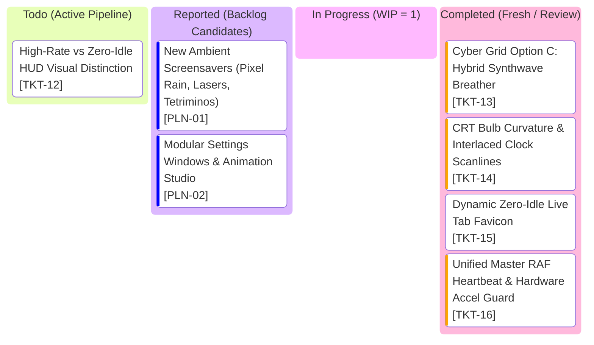

# Clockity Kanban Board

## Active Glance Index

| Ticket ID | Grade | Title | Operational Inspiration | Spec Document |
| :--- | :--- | :--- | :--- | :--- |
| **`TKT-13`** | `TKT` | Cyber Grid Option C: Hybrid Synthwave Breather | Undulating crossbar terrain & breathing ribs | [TKT-13.md](./tasks/archived/TKT-13.md) |
| **`TKT-14`** | `TKT` | CRT Bulb Curvature & Interlaced Clock Scanlines | Beam interlaced clock digits & glass tube framing | [TKT-14.md](./tasks/archived/TKT-14.md) |
| **`TKT-15`** | `TKT` | Dynamic Zero-Idle Live Tab Favicon | Tickless analog neon clock dial in theme color | [TKT-15.md](./tasks/archived/TKT-15.md) |
| **`TKT-16`** | `TKT` | Unified Master RAF Heartbeat & Hardware Accel Guard | Single coordinated loop, zero-copy scanout & GPU probe | [TKT-16.md](./tasks/archived/TKT-16.md) |
| **`TKT-12`** | `TKT` | High-Rate vs Zero-Idle HUD Visual Distinction | Clear demarcation of 0 Hz sleep vs active RAF | [TKT-12.md](./tasks/TKT-12.md) |
| **`PLN-01`** | `PLN` | New Ambient Screensavers | Pixel rain, random lasers, rotating tetriminos | [PLN-01.md](./tasks/backlog/PLN-01.md) |
| **`PLN-02`** | `PLN` | Modular Settings Windows & Animation Studio | Multi-pane tabbed menus & JSON preset backup | [PLN-02.md](./tasks/backlog/PLN-02.md) |
