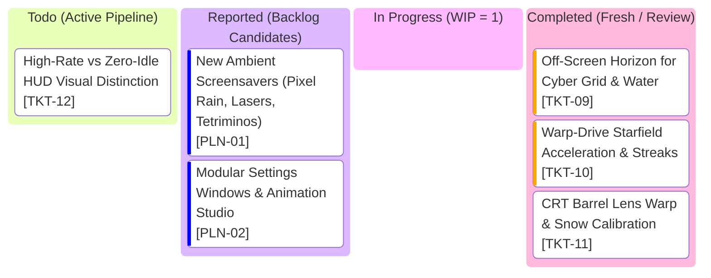

# Clockity Kanban Board

## Active Glance Index

| Ticket ID | Grade | Title | Operational Inspiration | Spec Document |
| :--- | :--- | :--- | :--- | :--- |
| **`TKT-09`** | `TKT` | Off-Screen Horizon for Cyber Grid & Water | Zero-hotspot full-screen perspective projection | [TKT-09.md](file:///c:/Users/AlitheiaDeus/DeusLocker/L2C/Clockity/tasks/archived/TKT-09.md) |
| **`TKT-10`** | `TKT` | Warp-Drive Starfield Acceleration & Streaks | Hyperbolic Z-acceleration & speed laser streaks | [TKT-10.md](file:///c:/Users/AlitheiaDeus/DeusLocker/L2C/Clockity/tasks/archived/TKT-10.md) |
| **`TKT-11`** | `TKT` | CRT Barrel Lens Warp & Snow Calibration | Curved glass bulb distortion & contrast floor | [TKT-11.md](file:///c:/Users/AlitheiaDeus/DeusLocker/L2C/Clockity/tasks/archived/TKT-11.md) |
| **`TKT-12`** | `TKT` | High-Rate vs Zero-Idle HUD Visual Distinction | Clear demarcation of 0 Hz sleep vs active RAF | [TKT-12.md](file:///c:/Users/AlitheiaDeus/DeusLocker/L2C/Clockity/tasks/TKT-12.md) |
| **`PLN-01`** | `PLN` | New Ambient Screensavers | Pixel rain, random lasers, rotating tetriminos | [PLN-01.md](file:///c:/Users/AlitheiaDeus/DeusLocker/L2C/Clockity/tasks/backlog/PLN-01.md) |
| **`PLN-02`** | `PLN` | Modular Settings Windows & Animation Studio | Multi-pane tabbed menus & JSON preset backup | [PLN-02.md](file:///c:/Users/AlitheiaDeus/DeusLocker/L2C/Clockity/tasks/backlog/PLN-02.md) |
