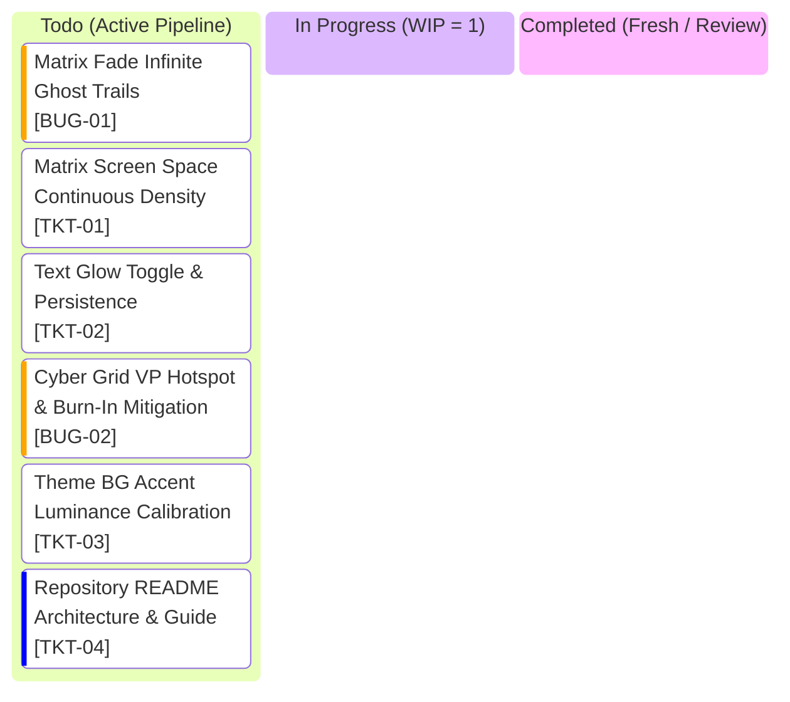

# Clockity Kanban Board

## Active Glance Index

| Ticket ID | Grade | Title | Operational Inspiration | Spec Document |
| :--- | :--- | :--- | :--- | :--- |
| **`BUG-01`** | `BUG` | Matrix Fade Infinite Ghost Trails | Elimination of residual canvas alpha trails | [BUG-01.md](file:///c:/Users/AlitheiaDeus/DeusLocker/L2C/Clockity/tasks/BUG-01.md) |
| **`TKT-01`** | `TKT` | Matrix Screen Space Continuous Density | Procedural drop positioning across viewport | [TKT-01.md](file:///c:/Users/AlitheiaDeus/DeusLocker/L2C/Clockity/tasks/TKT-01.md) |
| **`TKT-02`** | `TKT` | Text Glow Toggle & Persistence | Drawer setting for flat vs neon styling | [TKT-02.md](file:///c:/Users/AlitheiaDeus/DeusLocker/L2C/Clockity/tasks/TKT-02.md) |
| **`BUG-02`** | `BUG` | Cyber Grid VP Hotspot & Burn-In Mitigation | OLED safe diffusion & perspective lighting | [BUG-02.md](file:///c:/Users/AlitheiaDeus/DeusLocker/L2C/Clockity/tasks/BUG-02.md) |
| **`TKT-03`** | `TKT` | Theme BG Accent Luminance Calibration | Balanced background particle visibility | [TKT-03.md](file:///c:/Users/AlitheiaDeus/DeusLocker/L2C/Clockity/tasks/TKT-03.md) |
| **`TKT-04`** | `TKT` | Repository README Architecture & Guide | Project showcase & quickstart documentation | [TKT-04.md](file:///c:/Users/AlitheiaDeus/DeusLocker/L2C/Clockity/tasks/TKT-04.md) |
