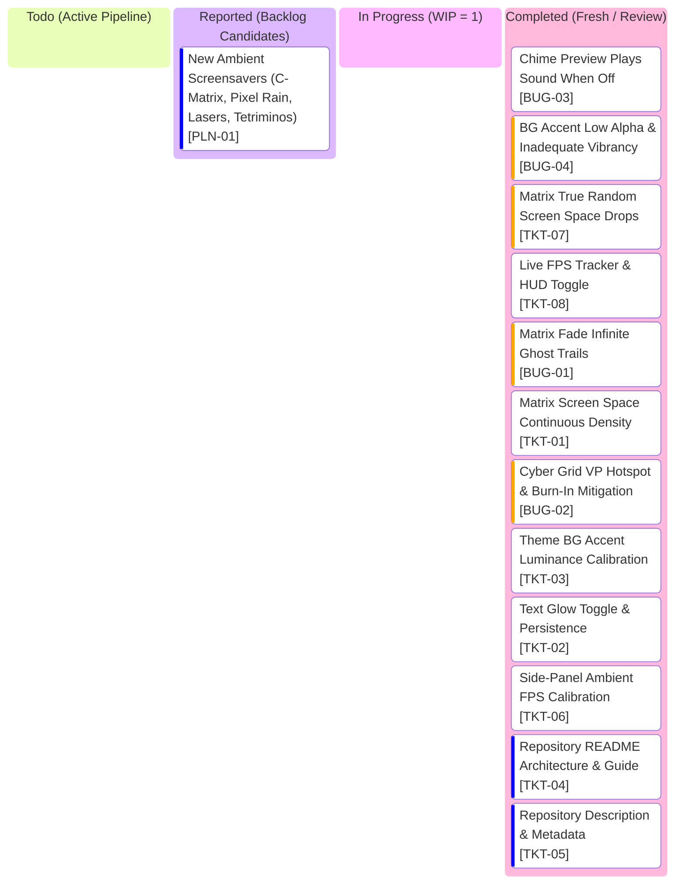

# Clockity Kanban Board

## Active Glance Index

| Ticket ID | Grade | Title | Operational Inspiration | Spec Document |
| :--- | :--- | :--- | :--- | :--- |
| **`BUG-03`** | `BUG` | Chime Preview Plays Sound When Off | Prevent unprompted sound when chime disabled | [BUG-03.md](file:///c:/Users/AlitheiaDeus/DeusLocker/L2C/Clockity/tasks/BUG-03.md) |
| **`BUG-04`** | `BUG` | BG Accent Low Alpha & Inadequate Vibrancy | Alpha tuning & theme accent luminance boost | [BUG-04.md](file:///c:/Users/AlitheiaDeus/DeusLocker/L2C/Clockity/tasks/BUG-04.md) |
| **`TKT-07`** | `TKT` | Matrix True Random Screen Space Drops | Continuous randomized screensaver distribution | [TKT-07.md](file:///c:/Users/AlitheiaDeus/DeusLocker/L2C/Clockity/tasks/TKT-07.md) |
| **`TKT-08`** | `TKT` | Live FPS Tracker & HUD Toggle | Real-time FPS performance measurement HUD | [TKT-08.md](file:///c:/Users/AlitheiaDeus/DeusLocker/L2C/Clockity/tasks/TKT-08.md) |
| **`PLN-01`** | `PLN` | New Ambient Screensavers | Pixel rain, random lasers, rotating tetriminos | [PLN-01.md](file:///c:/Users/AlitheiaDeus/DeusLocker/L2C/Clockity/tasks/backlog/PLN-01.md) |
