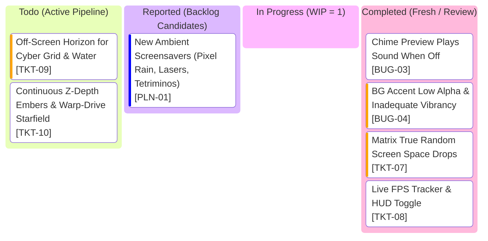

# Clockity Kanban Board

## Active Glance Index

| Ticket ID | Grade | Title | Operational Inspiration | Spec Document |
| :--- | :--- | :--- | :--- | :--- |
| **`TKT-09`** | `TKT` | Off-Screen Horizon for Cyber Grid & Water | Zero-hotspot full-screen perspective projection | [TKT-09.md](file:///c:/Users/AlitheiaDeus/DeusLocker/L2C/Clockity/tasks/TKT-09.md) |
| **`TKT-10`** | `TKT` | Continuous Z-Depth Embers & Warp-Drive Starfield | Smooth 3D volume drifting & relativistic warp speed streaks | [TKT-10.md](file:///c:/Users/AlitheiaDeus/DeusLocker/L2C/Clockity/tasks/TKT-10.md) |
| **`PLN-01`** | `PLN` | New Ambient Screensavers | Pixel rain, random lasers, rotating tetriminos | [PLN-01.md](file:///c:/Users/AlitheiaDeus/DeusLocker/L2C/Clockity/tasks/backlog/PLN-01.md) |
